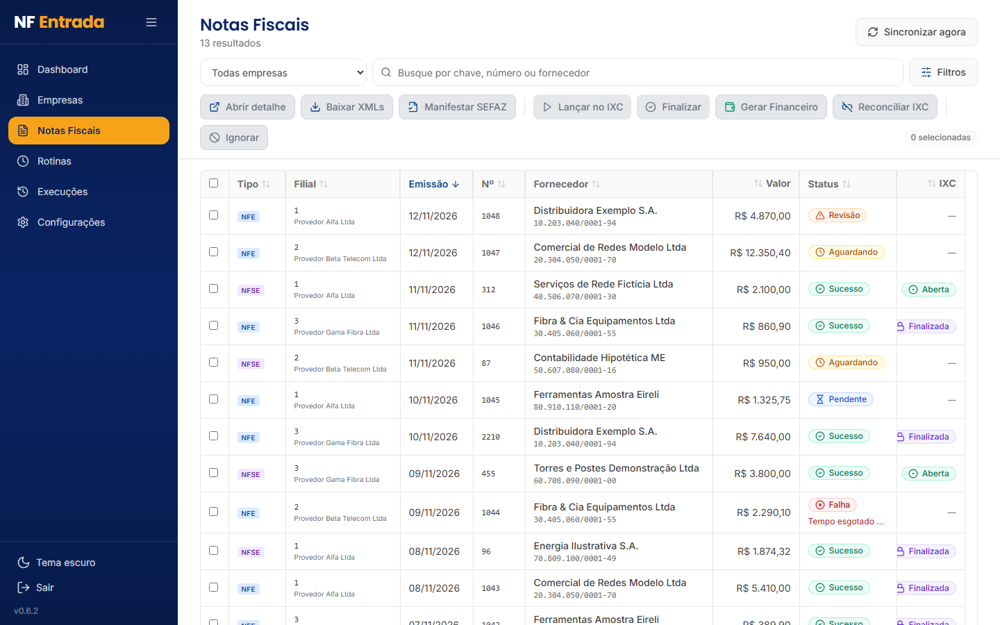
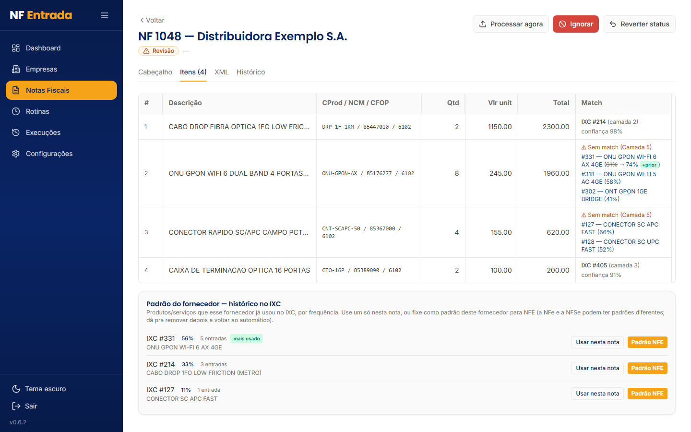
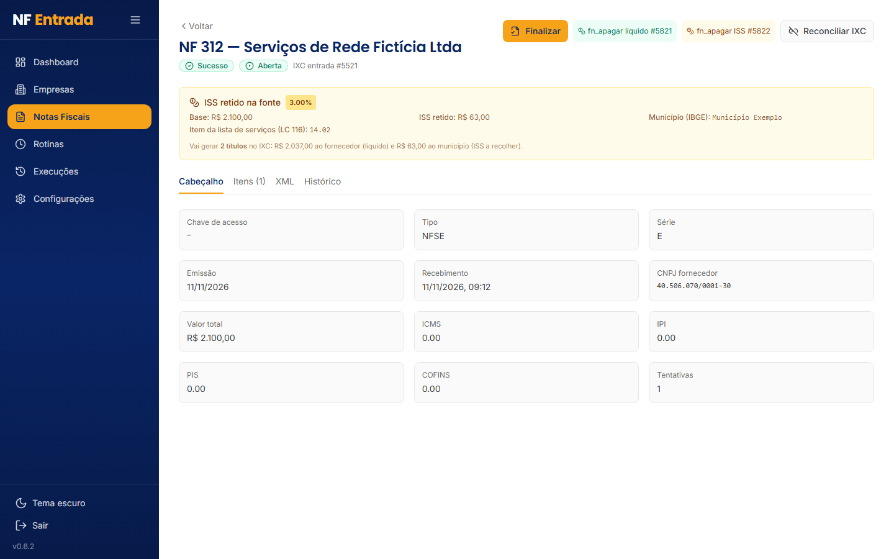

# Lançamento automático de notas fiscais

Fiz este sistema para um grupo de provedores de internet parar de digitar nota fiscal no ERP. Ele está em produção. O código é da empresa, então aqui ficam a história e as telas.

## O problema

São cerca de dez empresas recebendo notas o mês inteiro, e tudo era digitado à mão. Saía produto errado, imposto errado e, às vezes, a mesma nota lançada duas vezes.

## O que o sistema faz

Busca as notas recebidas, lê o XML, descobre qual produto do cadastro corresponde a cada item e lança no ERP com financeiro e impostos. Nada é lançado sem alguém aprovar, seja na hora ou deixando uma rotina configurada.

Aprovar não precisa ser uma por uma. Na lista, dá para marcar várias notas (até 500) e lançar, finalizar ou ignorar todas de uma vez. Se alguma não puder seguir, o sistema diz o motivo e continua com as outras.

Também dá para deixar rotinas agendadas por empresa: uma que só busca as notas novas, outra que lança, finaliza ou faz as duas coisas. Cada rotina pode ser filtrada por tipo de nota, fornecedor e faixa de valor, e pode ser pausada quando precisar.

Da mesma lista, o sistema confirma o recebimento das notas na SEFAZ e baixa os XMLs das notas selecionadas, ou do mês inteiro, num ZIP. Se alguém lançar uma nota direto no ERP, ele percebe, liga ao registro e não lança de novo.

Quando não tem certeza de qual produto é, ele mostra as opções e a pessoa escolhe.

Antes de lançar, a tela mostra quanto vai para o fornecedor e quanto vai de imposto.

## Acompanhamento

Um painel mostra, por empresa, quantas notas estão esperando, lançadas ou com problema. Cada rotina deixa registrado quando rodou e o que fez, e cada chamada ao ERP fica guardada para consulta.

## O que deu trabalho

- **O ERP mentia.** Ele respondia "sucesso", mas não gravava a chave da nota. Tive que mudar a forma de evitar lançamento duplicado.
- **Achar o produto certo.** No XML vem "CABO DROP 1FO LOW FRIC"; no cadastro está "Cabo drop 1 fibra". O sistema tenta seis caminhos e só decide sozinho com mais de 85% de certeza. Antes de mudar essa regra, eu rodo a versão nova nas notas antigas, sem gravar nada, para ver quantas ela acertaria.
- **Rotinas no mesmo minuto.** Várias rodavam juntas e esgotavam as conexões do banco. Espalhei os horários e limitei quantas rodam ao mesmo tempo.

## Tecnologias

Python, FastAPI, PostgreSQL, Redis, React, TypeScript, Docker, Prometheus e Grafana.

## Em números

6 meses de trabalho, 286 commits e cerca de 1.070 testes automatizados.

---

As telas usam dados fictícios.
